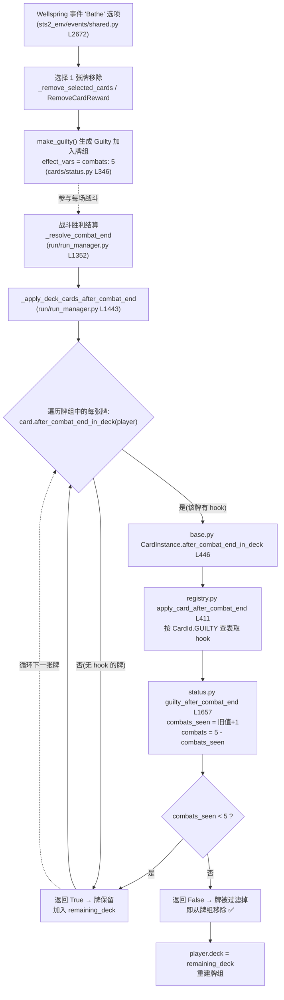

# 愧疚(Guilty)诅咒牌 — 移除逻辑图解

> Guilty(愧疚)是一张不可打出的诅咒牌：加入牌组后，每经历 1 场战斗计数 +1，累计 **5 场战斗**后自动从牌组消失（对应原版 `MegaCrit.Sts2.Core.Models.Cards/Guilty.cs` 的 `AfterCombatEnd` → `CardPileCmd.RemoveFromDeck`）。

## 流程图



## 处理逻辑位置详解

### 1. 卡牌从哪来
- 只有 **Wellspring 事件**的 `Bathe`（沐浴）选项会赠送 Guilty，同时先让你移除一张牌：
  - [events/shared.py L2672-L2727](file:///c:/Project/sts2-rl-agent/sts2_env/events/shared.py#L2672-L2727)
- 工厂函数 [status.py `make_guilty()` L346-L352](file:///c:/Project/sts2-rl-agent/sts2_env/cards/status.py#L346-L352)，初始 `effect_vars={"combats": 5}`，上限常量 `GUILTY_MAX_COMBATS = 5`（[status.py L42](file:///c:/Project/sts2-rl-agent/sts2_env/cards/status.py#L42)）。

### 2. 移除判定的三个关键点

| 步骤 | 文件位置 | 作用 |
|---|---|---|
| 计数/判定 hook | [cards/status.py L1657-L1662](file:///c:/Project/sts2-rl-agent/sts2_env/cards/status.py#L1657-L1662) `guilty_after_combat_end` | `combats_seen +1`，更新剩余 `combats`，返回 `seen < 5`（True=保留 / False=移除） |
| 统一入口 | [cards/base.py L446-L449](file:///c:/Project/sts2-rl-agent/sts2_env/cards/base.py#L446-L449) `after_combat_end_in_deck` | 每张牌的通用回调入口 |
| 查表分发 | [cards/registry.py L411-L415](file:///c:/Project/sts2-rl-agent/sts2_env/cards/registry.py#L411-L415) `apply_card_after_combat_end` | 按 `CardId.GUILTY` 从 `_CARD_AFTER_COMBAT_END_HOOKS` 取出 hook；无 hook 的牌默认保留 |

### 3. 真正执行"删除"的地方（重点）
[run/run_manager.py `_apply_deck_cards_after_combat_end` L1443-L1449](file:///c:/Project/sts2-rl-agent/sts2_env/run/run_manager.py#L1443-L1449)

```python
def _apply_deck_cards_after_combat_end(self) -> None:
    player = self._run_state.player
    remaining_deck: list[CardInstance] = []
    for card in player.deck:
        if card.after_combat_end_in_deck(player):
            remaining_deck.append(card)   # hook 返回 False 的牌不被加入 → 被移除
    player.deck = remaining_deck
```

**关键点**：hook 只返回"是否保留"，不直接删除；删除是**重建牌组过滤**实现的——hook 返回 `False`（战斗数已达 5）的牌不会被放进 `remaining_deck`，最终 `player.deck = remaining_deck` 后该牌即从牌组消失。

### 4. 触发时机
`_apply_deck_cards_after_combat_end` 由战斗胜利结算 [run_manager.py `_resolve_combat_end` L1377](file:///c:/Project/sts2-rl-agent/sts2_env/run/run_manager.py#L1352-L1377) 调用，每场胜利后都会执行一次。

### 与原版 C# 的对照
原版 [Guilty.cs L45-L56](file:///c:/Project/sts2-rl-agent/decompiled/MegaCrit.Sts2.Core.Models.Cards/Guilty.cs#L45-L56) 在卡牌自身 `AfterCombatEnd` 里直接调用 `CardPileCmd.RemoveFromDeck(this)` 移除自己；本项目把它拆成了"卡牌 hook 返回判定结果" + "run_manager 统一过滤牌组"两个层次。
